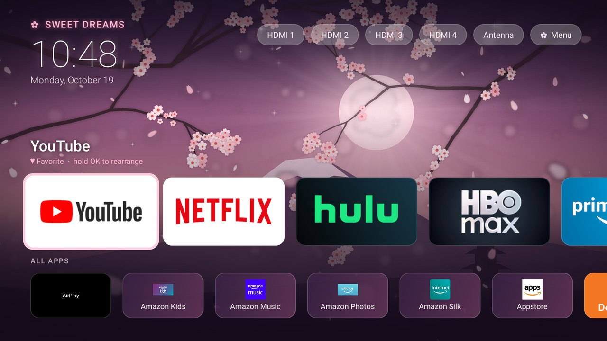
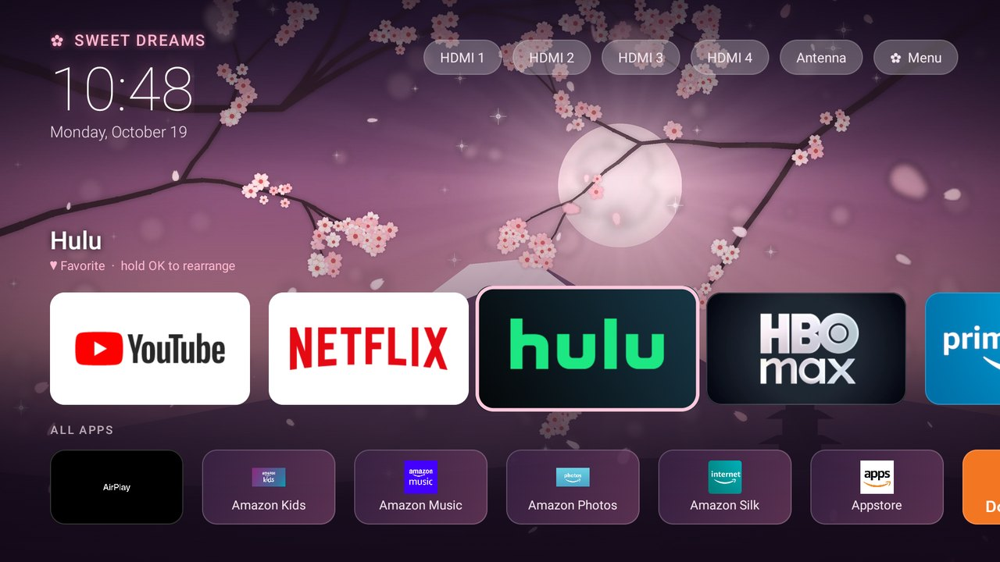
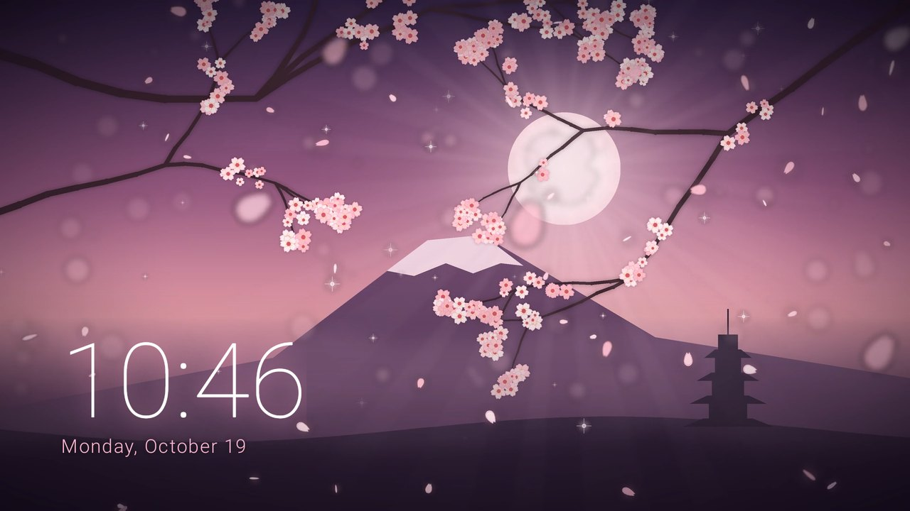
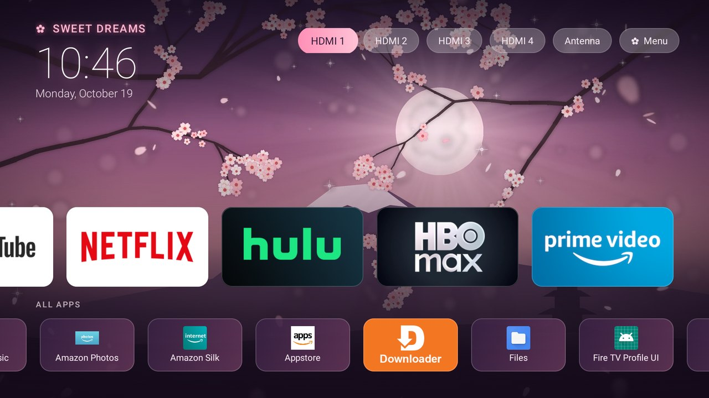

<div align="center">


# 🌸 Sakura Firetv

**A calm, ad-free cherry blossom home screen for Amazon Fire TV, plus the scripts to strip out the ads and tracking.**


-ffb7cf?style=flat-square)


</div>

---

Fire TVs ship with a home screen full of sponsored rows, autoplaying trailers and shopping prompts, plus several services that report what you watch. This project replaces all of that with a home screen you'd actually want to look at, and gives you one-command scripts to turn the rest off. Everything runs over ADB from a PC, nothing needs root, and every change can be undone.

<div align="center">

<br><sub>The live background: a seamless 20-second loop rendered from code</sub>
</div>

## ✨ What's inside

| | Part | What it does |
|---|---|---|
| 🏯 | [**Sakura Home**](app-launcher) | A custom launcher app with an animated cherry blossom scene, your apps as glowing cards, one-press TV inputs and an ambient clock mode. It takes over the Home button. |
| 🔇 | **HBO Max & Hulu ad muting** | Built into Sakura Home: it mutes the TV during HBO Max and Hulu ad breaks and unmutes when the show comes back. |
| 🧹 | [**Debloat scripts**](scripts) | Turn off ad tracking, Automatic Content Recognition (ACR), telemetry and nag apps, and speed up the UI. Includes a one-command undo. |
| 🎨 | [**Artwork generator**](artwork/generator) | The Python script that paints the wallpaper and renders the looping petal animation. |

## 🏯 Sakura Home

<div align="center">

<br><sub>Home screen on a real Fire TV: greeting, clock, input buttons, favorites and all apps</sub>
<br><br>
<table>
<tr>
<td></td>
<td></td>
</tr>
<tr>
<td align="center"><sub>Selected cards zoom in with a pink glow and a light sweep</sub></td>
<td align="center"><sub>Ambient mode after 3 idle minutes</sub></td>
</tr>
<tr>
<td colspan="2"></td>
</tr>
<tr>
<td colspan="2" align="center"><sub>One-press HDMI and antenna buttons, plus the ✿ Menu</sub></td>
</tr>
</table>
</div>

**Home screen**
- 🌙 **Living background**: falling petals, a glowing textured moon with slowly turning light rays, twinkling sparkles, drifting valley mist, and large out-of-focus foreground petals for depth.
- 🕰️ **Glowing clock and date**, with a greeting that changes through the day (*Good morning* … *Sweet dreams*).
- 💗 **Favorites row**: big banner cards that zoom in with a pink glow, a soft shadow and a light sweep when selected.
- 🗂️ **All Apps row**: every installed app, with clutter hidden.
- 📺 **TV input buttons**: one press for **HDMI 1–4**, using your custom input names if you've set any. App-registered "inputs" are filtered out. HDMI plays in Sakura Home's own full-screen player (Amazon's player only accepts Amazon-signed apps): a pink label names the input, *No signal* shows if the device is off, the TV stays awake however long you use it, and **Back** returns home. **Antenna** opens Live TV settings to scan channels, because antenna playback is also locked to Amazon apps.
- ⌕ **Search**: type a few letters to open a matching app, or jump to HBO Max's search page. For shows and movies, hold the remote's **Alexa** button and say what you want; it searches inside every app. (Amazon's search screen only accepts Amazon-signed apps, and YouTube, Hulu and Prime Video ignore search words sent by other apps.)
- ▢ **Open apps**: like a phone's recents. The button shows how many apps are open; pick one to close it, or **Close all**, to free memory on the TV's small 1.8 GB. Holding OK on a card also offers **Close app**, and ✿ Menu can close everything automatically when you press Home. Fire OS ignores the normal "close app" request from other apps, so Sakura Home presses **Force stop** in each app's settings page for you, behind a sakura cover screen. Netflix is the exception: Fire OS keeps it running itself, so it stays open.
- ✿ **Menu**: Fire TV settings, ambient mode, the HBO Max & Hulu ad-mute switch, auto-close and hidden apps.

**Make it yours**
- Hold **OK** on any app to **add it to favorites, move it left or right, remove it, or hide it**.
- Hidden apps can be brought back from ✿ Menu → *Show hidden apps*.

**Ambient mode**
- After 3 minutes without a button press (or when you press **Back** on the home screen), the menus fade away and leave the sakura scene with a large glowing clock. Any button wakes it.

**Behaves like a real home screen**
- The **Home button** always lands on Sakura Home with your first favorite selected, including from inside apps.
- **Starts on boot.**
- Pauses its video when an app opens, so streaming apps get the full video decoder.

### 🔇 HBO Max & Hulu ad muting

HBO Max and Hulu expose nothing that other apps can read: no "now playing" info, no readable on-screen text, and no standard audio player. During an ad break, though, each always draws the same yellow badge in a fixed corner: top-left on HBO Max, top-right next to the countdown on Hulu.

<div align="center">&nbsp;&nbsp;</div>

The video itself is copy-protected and shows up black in screenshots, but this badge doesn't. So while either app is in front, Sakura Home checks that small corner **once a second**:

1. **Badge appears**: it mutes the TV and shows a small pink **✿ Ad muted** tag.
2. **Badge is gone for 2 seconds**: it unmutes.

It only undoes a mute it made itself, so if you mute the TV yourself it stays muted. Nothing is recorded or sent anywhere; each check looks at a few thousand pixels and throws them away. You can switch it off in ✿ Menu. ✅ Tested on real HBO Max and Hulu ad breaks.

> This only mutes your own speakers. Ads still play, nothing is skipped or blocked, and your subscription works exactly as before.

### How the Home button takeover works

Fire OS doesn't let you change the default launcher, so Sakura Home uses an **accessibility service**. It catches the remote's Home button itself, so Amazon's home screen (and the ads it autoplays) never opens. If Amazon's home does come up some other way, such as at startup, Sakura Home opens on top within a fraction of a second. A few details make this work well:
- **Hold Home** to open Fire TV settings. Amazon's quick-settings panel only accepts Amazon-signed apps, so this replaces it.
- Fire OS hosts its main **Settings** screen inside Amazon's home app, so Sakura Home briefly allows it whenever you open Settings. Otherwise you could never reach them.
- It only acts on Amazon's *home* activity, so Alexa, Amazon search and profiles still work.

## 🧹 What the debloat script changes

| Change | Why |
|---|---|
| **ACR off** (`com.amazon.tv.acr`) | Automatic Content Recognition identifies what's on your screen, including HDMI devices and antenna TV, for ad targeting. |
| **Limit ad tracking** (Amazon and third-party apps) | Stops interest-based ad profiling. |
| **Usage, marketing and app-usage uploads off** | Stops the device reporting how you use it. |
| **Advertising ID service, telemetry, logging and Wi-Fi metrics disabled** | These run in the background and phone home. |
| **"Special Offers" ad service, sponsored recommendations, ad screensaver and promo notifications disabled** | The rest of Amazon's own ads. (Ambient Experience stays on because it also draws Alexa's voice search; with sleep and the screensaver off, its idle ad cards never come up.) |
| **Shopping, miniTV, demo content, tutorials, release notes, Luna hub, forced-update prompts disabled** | Bloat and nags. |
| **Never sleeps on its own**; HDMI devices can't put it in standby | Fire OS only counts remote presses as activity, so it switched off after 14 minutes on a PC or console. Turn it off yourself with the power button. |
| **Animations 1× → 0.5×** | Menus feel noticeably snappier. |
| *Optional* `-RemoveApps` | Uninstalls preinstalled apps you don't use. Edit the list first, and reinstall any time from the Appstore. |

Apps are **disabled, not deleted**, so `restore-firetv.ps1` brings everything back. Amazon protects its ad deep-link service and its metrics client from being disabled, so the script *suspends* them instead: they can't open screens or run in the background. All of this survives a restart.

Two TV settings worth changing by hand:
- **Settings → Preferences → Featured Content**: turn off video and audio autoplay.
- **Settings → Display & Sounds → Sound Settings → Advanced → Volume Leveler**: *Mid*. It evens out ads that are mixed louder than the show, on every app.

## 🚀 Setup

**You need:** a Fire TV (built on Fire OS 8 / Android 11; Fire OS 7 should mostly work) and a Windows PC on the same network.

1. **Turn on ADB on the TV.** Open Settings → My Fire TV → About, click the device name 7 times, then go to Developer Options → **ADB Debugging: On**.
2. **Find the TV's IP**: Settings → My Fire TV → About → Network.
3. **Get ADB.** Download Google's [platform-tools](https://developer.android.com/tools/releases/platform-tools) and unzip it.
4. **Connect** with `adb connect <tv-ip>:5555`, and accept the *Allow debugging?* prompt on the TV with **Always allow** ticked.
5. **Run what you want:**

```powershell
# Turn off ads, ACR and telemetry
.\scripts\debloat-firetv.ps1 -TvIp 192.168.1.50 -Adb C:\path\to\platform-tools\adb.exe

# Install Sakura Home (APK from the Releases page) and hand it the Home button
.\scripts\install-sakura-home.ps1 -TvIp 192.168.1.50 -Apk .\SakuraHome-1.3.apk -Adb C:\path\to\platform-tools\adb.exe
```

**Undo:** `restore-firetv.ps1` reverses the debloat, and `install-sakura-home.ps1 -Uninstall` removes the launcher.

> After updating Sakura Home, run the install script again. Android unbinds accessibility services when their app is reinstalled.

## 🛠️ Build from source

```powershell
cd app-launcher
# needs JDK 17+ and the Android SDK (platform 36); point ANDROID_HOME at it
.\gradlew.bat assembleRelease
# -> app\build\outputs\apk\release\app-release.apk
```

The code is plain Kotlin and Android Views, with RecyclerView as the only library, so it stays light on TV hardware:

```
app-launcher/app/src/main/java/com/sakura/home/
├── MainActivity.kt        home screen: video background, rows, inputs, menu, ambient mode
├── InputPlayerActivity.kt full-screen HDMI player built on Android's TvView
├── CardAdapter.kt         app cards and their glow, zoom and light-sweep focus animation
├── Apps.kt                finds installed apps and banners; saved favorites and hidden apps
├── OpenApps.kt            recents list and closing apps
├── SearchDialog.kt        search box: matching apps plus HBO Max's search page
├── HomeButtonService.kt   Home button takeover, start on boot, drives the ad muter
├── AppCloser.kt           closes apps by pressing Force stop in their settings page
└── AdMuter.kt             HBO Max and Hulu ad-badge detection and mute/unmute
```

### Regenerating the artwork

```powershell
pip install pillow imageio-ffmpeg
python artwork/generator/sakura.py artwork still          # wallpapers
python artwork/generator/sakura.py artwork video 600      # 20 s / 30 fps seamless loop
```

Every motion in the animation (petal fall, sway, spin, the rays' rotation, sparkle twinkle, mist drift) is a whole number of cycles per loop, so the video repeats with no visible seam.

## ⚠️ Notes

- Tested on a Fire TV smart TV (MediaTek, Fire OS 8.1.8). Fire TV sticks and cubes use the same Fire OS, but their input names and package lists differ slightly.
- The ad detection depends on how HBO Max and Hulu draw their ad badges today. If either changes the design, the check needs updating (one color and one screen area in `AdMuter.kt`).
- Turning off the main update service isn't possible without root, because Amazon protects it.
- Not affiliated with Amazon, Warner Bros. Discovery or any streaming service. All trademarks belong to their owners. You use this at your own risk, though everything here can be undone.

## License

[MIT](LICENSE): the code and the sakura artwork are free to use, change and share.
